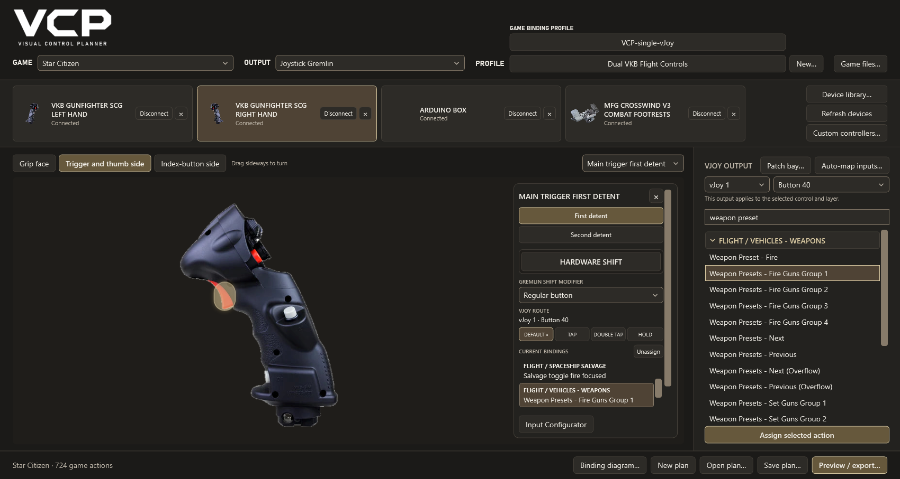
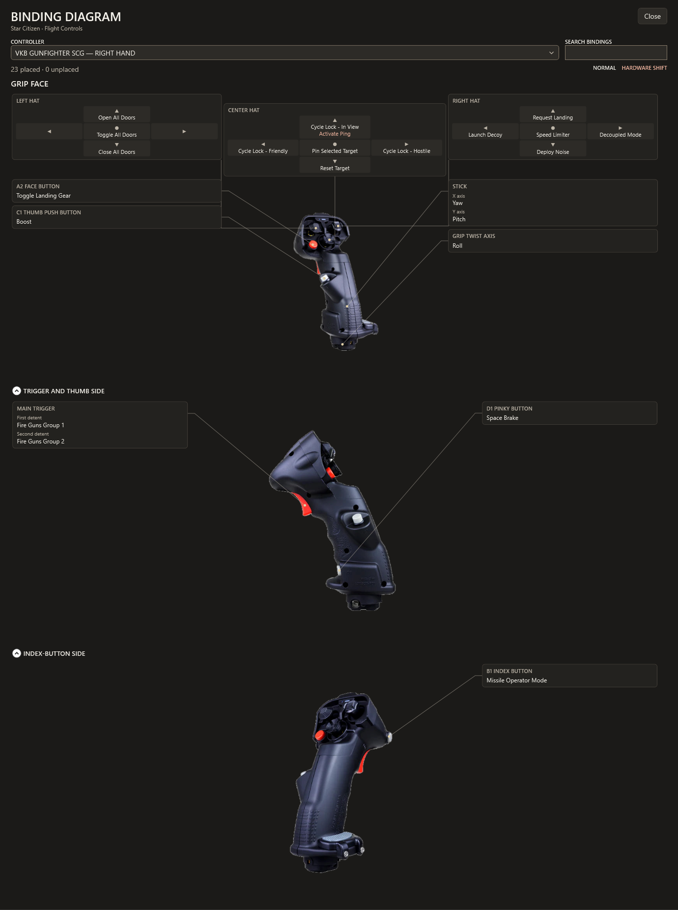
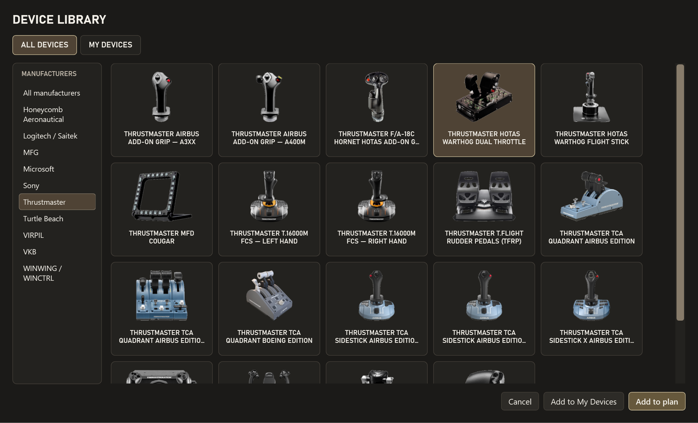
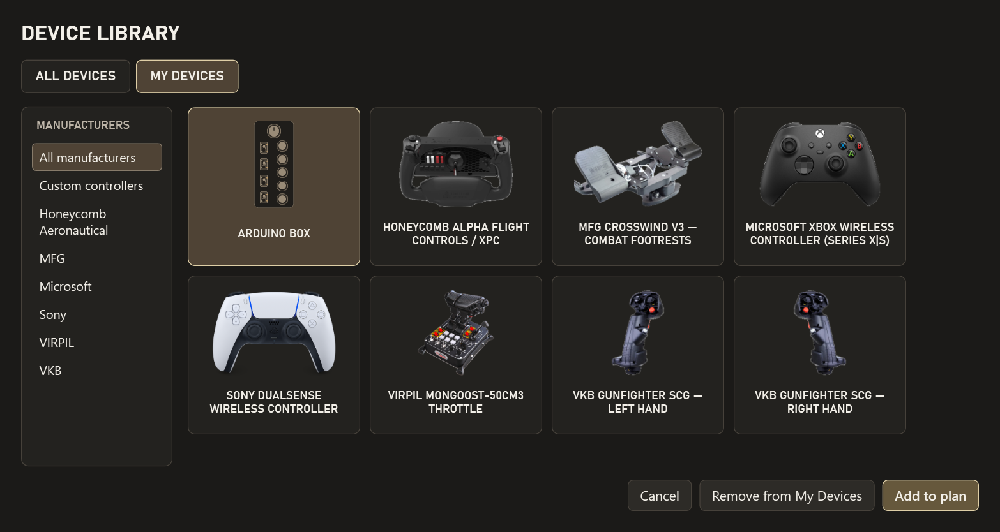
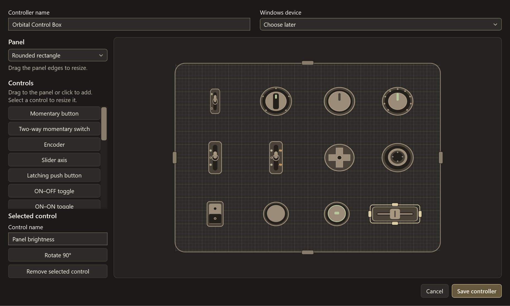
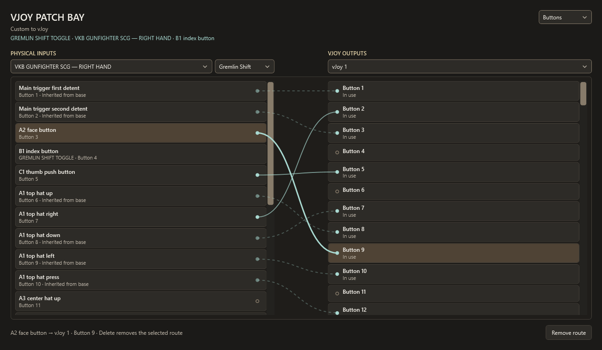

# Visual Control Planner

[](https://ko-fi.com/thetrufflegouda)

Visual Control Planner is an open source Windows app that aims to make planning, binding, and keeping track of your sim control profiles easier and more interactive, all in one place. It makes in-game binding options for supported games searchable and easy to assign to specific controls across multiple devices.

[Screenshots](#screenshots) · [Features](#features) · [Supported games](#supported-games) · [Download and install](#download-and-install) · [Changelog](CHANGELOG.md)

## Screenshots

### Main planner



The Star Citizen plan shows the right VKB Gunfighter trigger, where it routes in vJoy, and the actions assigned to it in the game.

### Binding diagram



The binding diagram opens in a separate window with all its views expanded, so you can keep it on screen as a visual reference for your devices. It lets you see where your bindings live at a glance, whether you're keeping track of complicated controls or hopping back into a game after an extended break. It also updates in real time as you make changes to your plan.

### Device library



You can browse a large library of flight sim gear by manufacturer, save the devices you own to **My Devices**, and create, save, and load plans that include whichever hardware you use for that game.

### My Devices



Open **My Devices** to find the gear you've saved and add it to another plan.

### Custom controller editor



VCP also supports creating custom devices in an editor for anyone with homebrewed controller hardware. Lay out the controls on a snap grid, resize or rotate them, and duplicate parts to match the device you built.

### vJoy patch bay



The patch bay shows which physical controls route to each vJoy button or axis. You can wire controls individually or auto-map buttons and available axes. Gremlin can use a button as a hold or toggle modifier alongside your controller's hardware shift layers.

## Features

### Creating and sharing plans

You can create a binding plan for a friend using their hardware setup. Use **Share plan…** to save a `.vbind.json` copy with your planned assignments, learned inputs, and vJoy routes. The copy leaves out your local paths and controller pairings, so your friend can connect their hardware and select their own game profile. Use **Save plan…** to keep those settings in your own working copy. You can also plan your own bindings before you've made your next gear purchase.

### Learning your controls

Click a control on the device image to see its assignments and jump to the corresponding game action. Learn one control at a time, or use **Input Configurator** to go through the buttons and axes on a hardware layer in order.

### Writing bindings to a game

You can manage your bindings or write them directly to a supported game file from the app. You can even create full mappings to vJoy and write them to a new Joystick Gremlin profile. For Star Citizen, War Thunder, and SWG Space, VCP can also update an existing Gremlin profile and write those vJoy bindings directly to the game file in the same export. **Preview / Export** shows the destination and changes before writing.

### Custom to vJoy

Custom to vJoy is an option for games outside VCP's built-in catalog or whose binding files VCP can't read. It serves as a way to map your physical devices to one or more vJoy devices and plan what they'll be bound to. Use **Edit actions** to create your own action names and categories so they match the game's binding menu. You can export the routes to Joystick Gremlin and keep the plan open as a reference while you set up those bindings in the game.

## Supported games

- DCS World
- Elite Dangerous
- IL-2 Sturmovik Great Battles
- IL-2 Sturmovik Cliffs of Dover Blitz
- Microsoft Flight Simulator 2020 and 2024
- Star Citizen
- Star Wars: Squadrons
- SWG Legends and SWG Restoration
- War Thunder

Profile formats, device setup, and export options vary by game. See [Using VCP](docs/usage.md) for the details and the [hardware inventory](HARDWARE-INVENTORY.md) for model references.

## Download and install

1. Open [Releases](https://github.com/thetrufflegouda/visual-control-planner/releases) and download `VCP-1.0-Windows-x64.zip`.
2. Extract the ZIP and run `VisualControlPlanner.exe`.
3. Keep `Support` beside the EXE. The portable executable includes the .NET Desktop Runtime.

### Verify the download

Compare the SHA-256 hash with `SHA256SUMS.txt` in the release.

```powershell
Get-FileHash .\VCP-1.0-Windows-x64.zip -Algorithm SHA256
```

## Build from source

Build on Windows with the .NET 8 SDK. Use PowerShell 7 to create the portable ZIP.

```powershell
dotnet build -c Release
./Publish-Portable.ps1 -Destination dist/VCP-Windows-x64
```

Run the profile checks with `dotnet run --project Tests/VisualControlPlanner.Tests.csproj -c Release`.
They use sample profiles and require no game installations or connected controllers.

## Project status

VCP 1.0 is the current Windows x64 release. See the [changelog](CHANGELOG.md) for what's in this build.

## License

VCP's source code is licensed under the [MIT License](LICENSE). Product photos, manufacturer marks, and bundled dependencies retain their own terms. See the [third-party notices](THIRD_PARTY_NOTICES.md).
